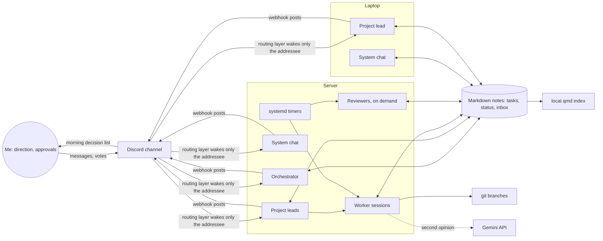

# Personal multi-agent system on Claude Code

A team of long-running Claude Code sessions that split work by role, coordinate in one Discord channel, keep all state in plain files, and run unattended for days on two machines.

- **Real work, not a demo.** It runs my side projects and the system itself: tools, scripts, reviews, research notes, nightly jobs.
- **Plain Claude Code underneath.** No custom agent framework. Each agent is a normal `claude` CLI session with a role file, a working folder and its own memory folder.
- **Files are the only source of truth.** Tasks, status, decisions and measurements live in a folder of Markdown notes. Chat messages only wake agents up.
- **Self-healing.** Crashed sessions resume the same conversation; scheduled jobs run through systemd timers; every change has a backup and a written rollback.
- **Measured.** Token usage per agent and per trigger, coordination overhead, and missed questions are logged daily.

## Architecture

| Role | Count | What it does |
|---|---|---|
| Orchestrator | 1 | Sets priorities, assigns work to project leads, triages the inbox, keeps the morning decision list. Does no hands-on work itself. |
| System chat | 1 per machine | Starts, restarts and closes the long-running sessions on its machine; owns the system tooling. |
| Project leads | 1 per project | Own a project, start short worker sessions, and are the only ones allowed to mark a task "verified". |
| Worker sessions | on demand | Fresh session, one task file, report back, exit. Keeps context small. |
| Reviewer chats | on demand | Logic reviewer, code reviewer, design reviewer, debugger, notes curator. Started as short `claude -p` runs with a role prompt ("fresh eyes"), they report findings and never fix code themselves. |

**Human in the loop.** I am not in the execution path, but I decide direction: every new part of the system needs my OK on a one-page proposal, and open decisions wait in a morning list as A/B questions I answer with one reaction. Agents keep working on other parts meanwhile instead of blocking.

**Machines.** A Linux server (Fedora, VM) runs most sessions inside tmux, each wrapped in a restart loop. A Windows laptop runs a few sessions; there they use targeted permission rules rather than the full bypass used on the server.

**Shared channel.** One Discord channel is the team room. Agents post through a webhook under their own name and avatar and receive messages through the official Claude Code Discord channel plugin. On top of the plugin sits my own routing layer, applied as an idempotent patch that is re-applied on every session start, so plugin updates do not drop it (the trade-off: it depends on the upstream code shape and has to be checked after updates). The routing rule is simple: **only the addressee wakes up.** A reply wakes the author of the replied message, an `@Name` wakes that agent, my votes go straight to the agent that asked, and webhook posts are always labelled as coming from an agent, never from me.

**State.** Task files (`tasks/<ID>.md` from one template: purpose, exact scope, a testable "done =" condition, what not to do, result), per-project `status.md`, an inbox log, and the morning decision list. Code work happens on per-task git branches or worktrees, committing only the files the task touched. The notes folder is synced between the machines and my phone with version history instead of git: many agents write at once, and the phone needs plain local files. Every edit additionally keeps a dated `.bak` copy.

**Supporting pieces.**
- **systemd user timers** (about 20): reviewer patrols, a change filter that starts a reviewer only when a plan or a "verified" status actually changes (capped at 5 runs/hour), the nightly job queue, measurement, indexing, backups.
- **Token measurement:** a script reads Claude Code transcript usage (numbers only, never content), weights it by API price, and groups it by agent and by trigger (my message, agent message, restart, scheduled). Plan usage percentage is logged every 15 minutes.
- **Gemini as a second opinion:** a small stdlib-only script calls the Gemini free tier for reviews and sanity checks. Only the text in question is sent, never our files or secrets. Its output is a starting point to verify, not a source.
- **Local semantic search (pilot):** [qmd](https://github.com/tobi/qmd) with a ~300 MB embedding model, indexed nightly on CPU, nothing leaves the machine. Files that contain secrets are excluded before indexing.

## Lessons learned

- **Approval layers backfired.** My first version had permission tiers, approval logs and confirm buttons. It mostly produced friction, so I removed them and kept only what reality forces: backups, rollback notes and review before deploy.
- **Coordination is expensive.** On a measured day, hands-on work was 44 % of weighted tokens, coordination 32 % and reviews/patrols 24 %. Short-lived reviewer sessions and addressee-only routing were the biggest savings; there is more to cut.
- **Anything that lives inside a conversation gets lost on restart.** A reaction watcher that ran inside the orchestrator's session silently stopped after a restart, and a decision went unseen. The fix was to move it into the plugin layer, with catch-up after restarts. Rule since then: background duties belong in code or timers, not in a model's memory.
- **Reminders aimed at the human did not work.** Of 65 reminders in ten days, I reacted to 8. They now go to the waiting agent with a nudge to continue another part.
- **Semantic search is a complement, not a replacement.** In a 10-question test the local index found the expected file 3/10 times and grep 7/10. The index still caught two that grep missed, and it returned about 750 tokens instead of up to about 20,000. The same test exposed a broken grep baseline in my own test script.
- **Files beat chat.** Anything said only in chat was eventually lost. Everything is now written to a file first.

## Task lifecycle

1. **Task file** written from the template, including a testable "done =" condition.
2. **Accepted:** the assignee answers `accepted: <ID>` in one line, or the sender resends after ~15 minutes.
3. **Plan review:** the logic reviewer checks the plan before it runs. A small change (about 20 lines or less) gets one check in total.
4. **Build:** backup first (`file.bak-<date>-<task>`), then unit tests, a dry run on live data, or a simulation on a copy. The task file gets a "Revert" section.
5. **Code review** by a fresh session for anything that touches the plugin layer or runs on a timer.
6. **Deployed**, then **verified**: only the project lead writes "verified", after checking the real result, not the agent's summary. A one-line `done: <ID> – <sentence>` goes to the orchestrator.

Quality gates against silent model mistakes are therefore tests, dry runs and an independent reviewer that reads the actual diff. There is no automated eval suite for model output yet.

States: idea, proposal, approved, in progress, deployed, verified (plus rejected, cancelled, postponed). New parts of the system follow research, a one-page proposal, my OK, a pilot, then a week of measurement.

## Reliability

- **Crash recovery:** the loop resumes the same conversation (`--resume <uuid>`). Three crashes in 10 minutes stop the loop and send a push notification. A planned restart is not counted as a crash, and after any restart the session reads the channel messages it missed.
- **Backups and rollback:** every edited file gets a dated `.bak` copy. Each task records how to undo it, including plugin cache restores.
- **Night runs:** in the evening a planner session proposes at most 3 safe night tasks. They run as fresh sessions in night mode (no reminders) and are summarised for the morning. I can cancel them with a single reaction.
- **Measurement over opinion:** daily tables record tokens per agent, how often I waited more than 15 minutes for an answer, messages lost in the channel, and verified tasks. One measured day, for scale: 7 tasks verified, 5 times I had to wait.

Code is private; happy to walk through it in a call.
